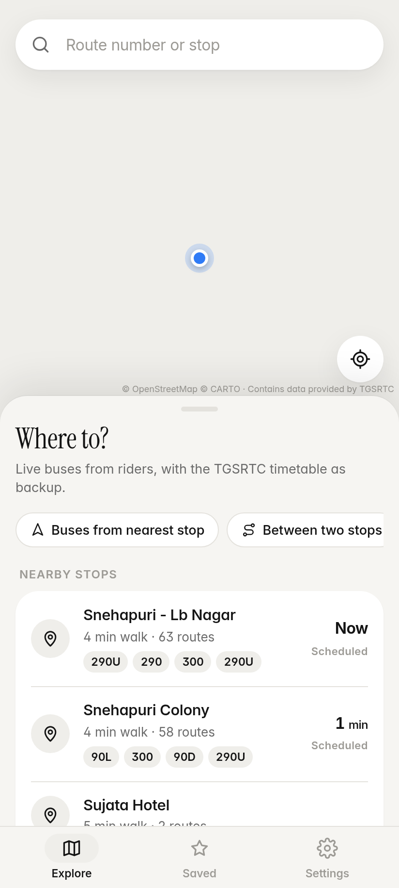
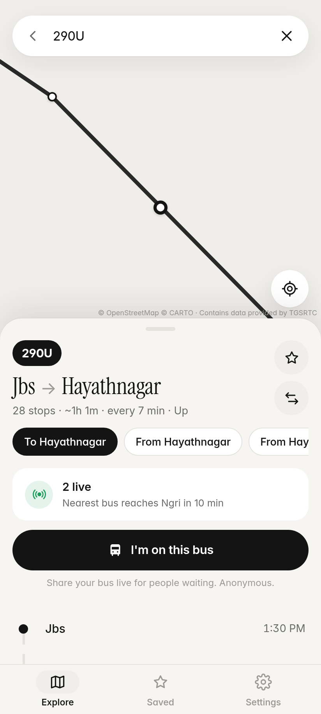
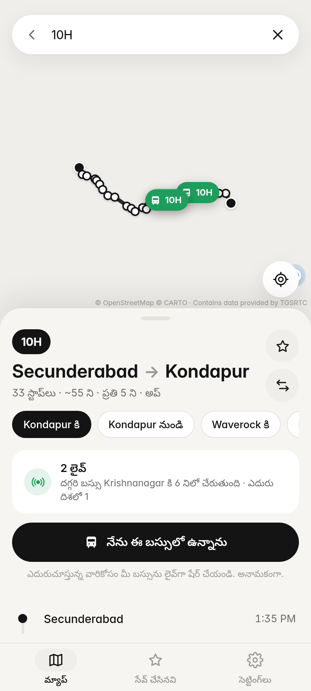
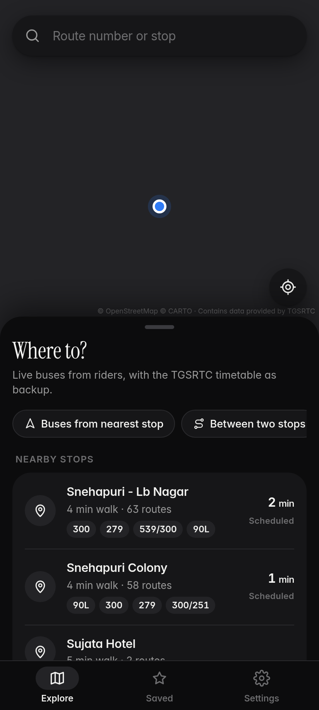

# Bus Bhai Hyderabad 🚌

Free, open-source Android bus app for Hyderabad and Telangana. No ads, no login, no tracking.

<p>
   
</p>

## Features
- Search TGSRTC city routes (290U, 10H, 219…) and stops, in English or Telugu
- Offline map of all of Telangana, no data needed to browse
- Nearby stops from your location
- Live bus positions shared anonymously by riders on the same bus (public MQTT broker)
- Light, dark and Telugu modes

## Download
**[Download the APK (v1.0.6, 4.9 MB)](https://github.com/sniff-yt/Bus-bhai/raw/main/BusBhaiHyderabad-v1.0.6.apk)**. Allow installs from unknown sources.

## How it works
A thin Java `WebView` shell (`src/`) loads a vanilla-JS app (`assets/`) built on Leaflet. Route and stop data are pre-baked into `assets/data/gtfs.json` from TGSRTC's open GTFS feed; the Telangana base map in `assets/data/map.json` is drawn from OpenStreetMap.

```
src/        Android activity (WebView host, location bridge)
assets/     HTML/CSS/JS app, fonts, data
res/        icons, styles
tools/      Python scripts that build gtfs.json, map.json and icons
test/       unit + browser tests, screenshot scripts
build.sh    Gradle-free build: aapt, javac, d8, zipalign, apksigner
```

## Build
Needs a JDK, `aapt`, `zipalign`, `apksigner`, `~/sdk/android-34/android.jar` and `~/sdk/r8.jar`.

```bash
KS_PASS=yourpassword VC=7 VN=1.0.6 ./build.sh
```
A new signing key is created on first build. APKs you build won't install over the official release, since they're signed with a different key.

## Contributing
Wrong or missing route? Open an issue with the route number and stops. PRs welcome, especially for district routes and timings.

## License
MIT. Map data © OpenStreetMap contributors (ODbL). Route data © TGSRTC open data.
